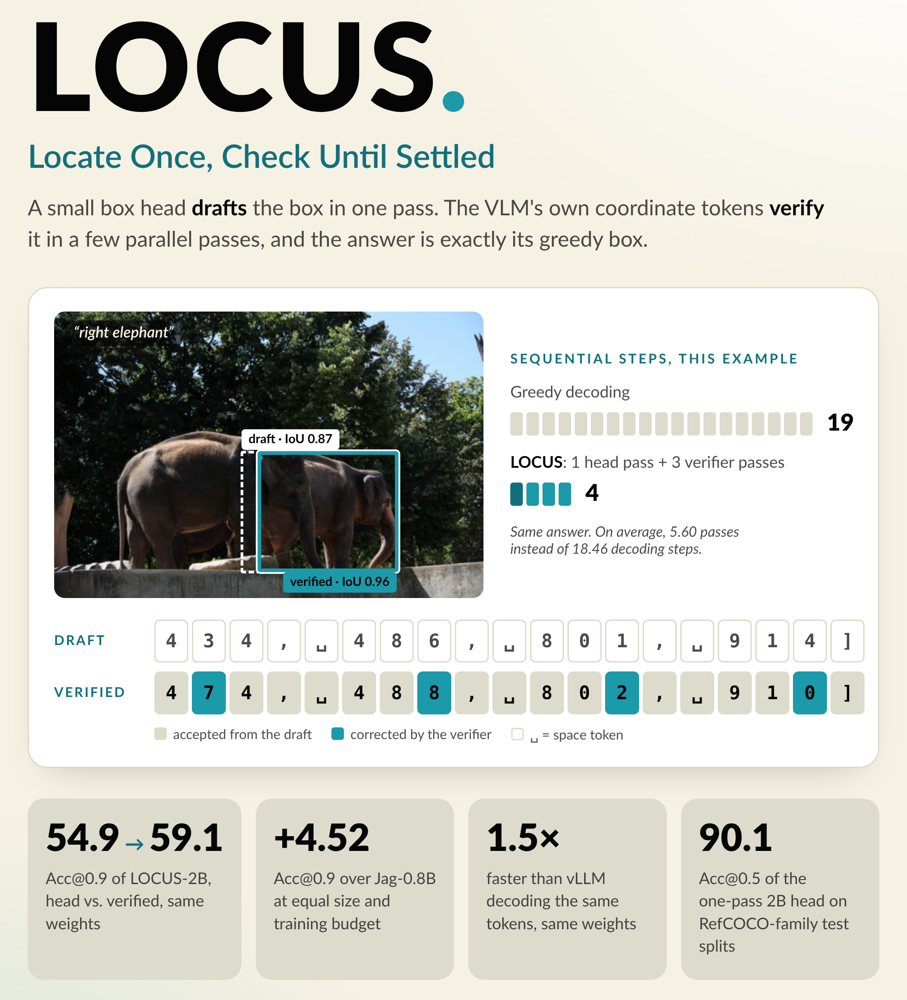

# LOCUS

[](https://muhammad-talha-ad.github.io/LOCUS/)
[](https://arxiv.org/abs/2610.35053)
[](https://huggingface.co/MTalha2001/LOCUS-2B)
[](https://huggingface.co/MTalha2001/LOCUS-0.8B)

**Locate Once, Check Until Settled.** Draft-and-verify referring-expression grounding for vision-language models.

<p align="center">
  
</p>

A VLM can ground an expression in two ways. It can write the box as coordinate tokens, which is precise but takes
about 18.46 sequential decoding steps per box. Or it can regress the box from one hidden state with a small
head, which takes one step but places edges less exactly. Locus uses the head as a speculative drafter for the model's
own coordinate tokens. The draft is rendered as the tokens the model would write, and the same model checks all of them
in parallel by Jacobi iteration, keeping the prefix it agrees with and correcting the next token until the draft stops
changing. With exact acceptance the result is the model's greedy coordinate-token box, reached in
5.60 passes on average.

```
image + "the man in the red shirt"
   │
   ├─ prefill once ──────────────── image KV cache, shared by every expression about this image
   │
   ├─ box branch ─── MLP head ───── draft box ──► rendered as coordinate tokens  "312, 88, 540, 702]"
   │
   └─ verifier branch (Jacobi) ──── keep the longest agreed prefix, correct the next token, repeat
                                    until the draft stops changing ──► the model's greedy box
```

Head and verifier are one set of weights, trained jointly on RefCOCO, RefCOCO+ and RefCOCOg.

## Results

Mean over the 8 RefCOCO / RefCOCO+ / RefCOCOg val and test splits. Every row was run in this repository's harness on
the same rows; baselines use their released weights. Locus runs at its 640² training budget, Jag at 512² and the
other baselines at their native resolution.

| Model | Output | Acc@0.5 | Acc@0.75 | Acc@0.9 | Passes |
|---|---|---|---|---|---|
| Locus-2B | head (one pass) | 90.01 | 79.79 | 54.87 | 1 |
| Locus-2B | verified, exact | 89.30 | 80.31 | 59.13 | 5.60 |
| Locus-2B | verified, typical (α = 0.5) | 89.60 | 80.49 | 58.95 | 3.43 |
| Locus-0.8B | head (one pass) | 87.97 | 75.58 | 47.03 | 1 |
| Locus-0.8B | verified, exact | 87.05 | 75.93 | 53.10 | 6.68 |
| Locus-0.8B | verified, typical (α = 0.7) | 87.17 | 76.14 | 53.29 | 4.37 |
| Jag-0.8B | regression head | 88.16 | 76.51 | 48.76 | 1 |
| LocateAnything-3B | box tokens | 88.68 | 80.82 | 65.55 | – |
| Hi-Token-3B | digit tokens | 87.24 | 76.93 | 54.75 | – |

- On the same weights, verification raises Acc@0.9 over the model's own head, at the cost of a few extra passes. The
  head is the more accurate output at Acc@0.5.
- Locus-0.8B uses the backbone and 2-epoch training budget of Jag-0.8B. It ties Jag at Acc@0.5 and, with typical
  acceptance, gains +4.52 points at Acc@0.9 (paired McNemar tests and an image-level bootstrap).
- LocateAnything-3B, a larger model trained on far more grounding data, is more accurate at high IoU.

**Evaluation hygiene.** The RefCOCO-family splits are drawn per dataset, so 46.9% of evaluation rows ask about
an object that is in another dataset's training split. Locus is trained with every evaluation image removed, and
`paper/tables/mcnemar.py --clean` repeats every comparison on the rows whose target no model has seen.

### Latency

One RTX A6000, batch 1, 512² inputs, end to end from the image file to the parsed box, 256 RefCOCO testA questions.
Jag, Locus and vLLM use CUDA graphs and GPU preprocessing.

| System | ms per question |
|---|---|
| Jag-0.8B, regression head | 20.3 |
| Locus-0.8B, head / exact | 25.5 / 63.5 |
| Locus-2B, head / typical (α = 0.5) / exact | 43.5 / 84.3 / 102.2 |
| Locus-2B weights decoding the same coordinate tokens in vLLM | 151.6 |
| Qwen3-VL-2B writing its full JSON answer in vLLM | 297.2 |

Exact verification returns the same box as greedy decoding 1.5× faster than vLLM decoding
those tokens with the same weights. A pure regression head is faster still.

## Install

```bash
pip install -e .               # Python 3.12 and a CUDA GPU; versions in pyproject.toml
python scripts/setup_data.py   # RefCOCO/+/g annotations, COCO-2017 train images (~18 GB), Jag baseline weights
```

`setup_data.py` is only needed to train or evaluate; inference with a released model needs `pip install -e .` alone.

## Inference with a released model

```python
from PIL import Image
from locus.hub import from_pretrained, ground

m = from_pretrained("MTalha2001/LOCUS-2B")   # trained weights from this repo; the base VLM from its own Hub repo
image = Image.open("street.jpg")
for r in ground(m, image, ["the man in the red shirt", "the bus on the left"]):
    print(r["expression"], r["box"], r["passes"])
```

All expressions about one image share a single image prefill. Each result holds:

| Key | Meaning |
|---|---|
| `box` | answer box `[x0, y0, x1, y1]` in pixels |
| `head_box` | the head's one-pass draft |
| `confidence` | the head's IoU-aware confidence |
| `passes` | verifier passes used (0 with `verify=False`) |

Options:
- `accept=1.0` (default): exact acceptance; the box is the model's greedy coordinate-token answer. In bf16 this holds
  up to the same rounding that already makes two greedy runs with different batch shapes differ.
- `accept=0.7` or `0.5`: typical acceptance; fewer passes, no longer exactly greedy.
- `verify=False`: return the head's draft only (one pass, fastest).

## Gradio demo

```bash
pip install -e ".[demo]"
python scripts/demo.py
```

Open http://127.0.0.1:7860, upload an image and enter one expression per line. Pick LOCUS-2B or LOCUS-0.8B (each
is downloaded on first use) and exact, typical or head-only output; the page draws the boxes and lists each box's
confidence and verifier passes. `GRADIO_SHARE=True python scripts/demo.py` also prints a public link.

## Reproduce

| What | Command |
|---|---|
| Locus-2B (train + evaluate) | `bash scripts/reproduce/locus_2b.sh` |
| Locus-0.8B (train + evaluate) | `bash scripts/reproduce/locus_08b.sh` |
| Jag-0.8B baseline | `bash scripts/reproduce/baselines.sh` |
| Latency | `bash scripts/reproduce/latency.sh` |
| Tables and significance tests | `bash scripts/reproduce/tables.sh` |

Training uses the RefCOCO, RefCOCO+ and RefCOCOg train splits with every image that appears in an evaluation split
removed. Every run writes its config, seed and git commit to `results/`.

## Train on your own data

Training needs one CUDA GPU: about 48 GB for full fine-tuning at 2B, less at 0.8B or with LoRA.

### 1. Write your data as JSONL

One referring expression per line:

```json
{"image_id": "kitchen_0001", "path": "/data/images/kitchen_0001.jpg", "text": "the red mug left of the sink", "gt": [0.412, 0.530, 0.488, 0.641]}
```

| Field | Meaning |
|---|---|
| `image_id` | the same for every expression about one image (they share one image prefill); all strings or all integers |
| `path` | image file; an absolute path is safest (relative paths resolve from the directory you launch in) |
| `text` | the referring expression |
| `gt` | box `[x0, y0, x1, y1]` as **fractions** of the image width and height, not pixels |

From pixel boxes:

```python
import json
from PIL import Image

with open("data/my_train.jsonl", "w") as f:
    for path, text, (x0, y0, x1, y1) in my_rows:          # your (image path, expression, pixel box) rows
        w, h = Image.open(path).size
        f.write(json.dumps(dict(image_id=path, path=path, text=text, gt=[x0 / w, y0 / h, x1 / w, y1 / h])) + "\n")
```

Write a held-out file the same way (`data/my_val.jsonl`) with images that are not in the training file.

### 2. Train

The recipe of the released models (head and verifier trained jointly, full fine-tuning of the language model and
vision merger):

```bash
python scripts/train_box.py --backbone qwen3.5-0.8b --lora-r 0 --full-ft --lr-lora 1e-5 --head mlp \
  --shared --bs 4 --q 4 --ar-weight 1.0 --steps 6000 \
  --train-targets data/my_train.jsonl --target gt --eval-n 0 --final-splits --name my_locus_08b
```

- **Backbone.** `--backbone qwen3-vl-2b` for the 2B model; on a 48 GB GPU also pass `--fused-adam --accum 2`, as
  `scripts/reproduce/locus_2b.sh` does.
- **Steps.** One step is `--bs` images with up to `--q` expressions each, so epochs ≈ steps × bs × q / rows. The script
  prints the epoch count at start and saves it in `results/box_train/<name>.json`. The released models train for
  2 epochs.
- **No RefCOCO needed.** `--eval-n 0` and an empty `--final-splits` skip the RefCOCO evaluations, so
  `setup_data.py` is not needed. Leave both at their defaults after running `setup_data.py` to see how much
  RefCOCO accuracy changes.
- **Paths.** `--train-targets` is read relative to the repository root. The trained weights go to
  `data/ckpt/<name>.pt`.
- **Smaller GPU.** Replace `--lora-r 0 --full-ft --lr-lora 1e-5` with `--lora-r 64 --merger-lora`, and add
  `--decision-items 0`. LoRA runs otherwise end with a retention probe whose script is not in this repository.

### 3. Or fine-tune a released model

Convert the Hub release into the checkpoint format `--init` reads (run from the repository root):

```python
from pathlib import Path

import torch
from huggingface_hub import snapshot_download
from safetensors.torch import load_file

sd = load_file(Path(snapshot_download("MTalha2001/LOCUS-0.8B")) / "model.safetensors")
Path("data/ckpt").mkdir(parents=True, exist_ok=True)
torch.save({"box_embed": sd["box_embed"],
            "decoder": {k[len("decoder."):]: v for k, v in sd.items() if k.startswith("decoder.")},
            "lora": {k[len("weights."):]: v for k, v in sd.items() if k.startswith("weights.")}},
           "data/ckpt/locus_08b_release.pt")
```

Then run the step 2 command with `--init locus_08b_release` added. Keep the release's architecture flags:
`--backbone qwen3.5-0.8b --lora-r 0 --full-ft --head mlp`, or `--backbone qwen3-vl-2b` for `MTalha2001/LOCUS-2B`.
Starting from the release usually needs fewer steps than starting from the base VLM; check on your held-out file.

### 4. Export, run and evaluate

```bash
python -m locus.hub export my_locus_08b exported/my_locus_08b
```

`from_pretrained("exported/my_locus_08b")` then loads it like a released model. `scripts/eval_draft_verify.py` only
knows the RefCOCO splits, so score your held-out file directly:

```python
import json
from collections import defaultdict

import numpy as np
from PIL import Image

from locus.eval.grounding import iou_xyxy
from locus.hub import from_pretrained, ground

m = from_pretrained("exported/my_locus_08b")
by_path = defaultdict(list)
for line in open("data/my_val.jsonl"):
    r = json.loads(line)
    by_path[r["path"]].append(r)
pred, gt = [], []
for path, rows in by_path.items():
    img = Image.open(path)
    for r, out in zip(rows, ground(m, img, [r["text"] for r in rows])):  # one prefill per image
        pred.append([v / s for v, s in zip(out["box"], [img.width, img.height] * 2)])
        gt.append(r["gt"])
iou = iou_xyxy(np.array(pred), np.array(gt))
print({f"Acc@{t}": float((iou >= t).mean()) for t in (0.5, 0.75, 0.9)})
```

Pass `verify=False` to `ground` to score the one-pass head alone. Locus is trained at a 640² pixel budget (`--px`), and
small targets suffer (see Limitations); if your objects are small, raise `--px` for training and export.

## Limitations

- Trained on the RefCOCO family only. On Ref-L4's Objects365 images, whose targets are much smaller than any RefCOCO
  training target, Locus and Jag both fall far below the zero-shot base model.
- Slower than a pure regression head; verification adds passes in proportion to how often the draft is wrong.
- At 0.8B, exact verification lowers Acc@0.5 relative to the head.
- Released backbones stop at 2B.

## License

Code: Apache-2.0. Released weights are derived from Qwen3-VL-2B-Instruct and Qwen3.5-0.8B (Apache-2.0) and were
trained on RefCOCO/+/g annotations over COCO images; check those datasets' terms for your use.

## Acknowledgements

The box head follows [Jag](https://arxiv.org/abs/2610.13239); the backbones are from the Qwen team.

## Citation

```bibtex
@misc{talha2026locus,
  title         = {{LOCUS}: Locate Once, Check Until Settled. Draft-and-Verify Visual Grounding
                   with a Box Head and Coordinate-Token Verification},
  author        = {Talha, Muhammad},
  year          = {2026},
  eprint        = {2610.35053},
  archivePrefix = {arXiv},
  primaryClass  = {cs.CV},
  url           = {https://arxiv.org/abs/2610.35053}
}
```
